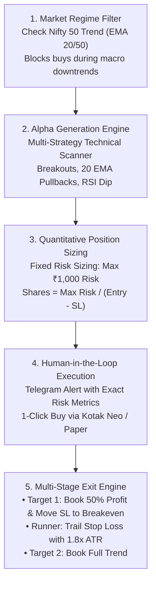

# 🏛️ Institutional Algorithmic Trading Architecture & Optimization Guide

This document breaks down how quantitative algorithmic trading systems operate at top hedge funds and proprietary trading firms, and how our system in `E:\TRADING` has been optimized to institutional standards.

---

## 🧠 The 5 Pillars of Quantitative Trading

---

## 🎯 Pillar 1: Market Regime Filter (`regime_filter.py`)
> *"Don't swim against the tide."*

Amateur traders often buy great stock setups even when the entire market is crashing. 
* **The Rule:** Before scanning any individual stock, the bot checks the benchmark index (**Nifty 50**).
* **Bull Regime (Close > 20 EMA > 50 EMA):** Full aggressive scanning enabled.
* **Neutral Regime (Close > 50 EMA):** Selective scanning allowed.
* **Bear Regime (Close < 50 EMA):** All swing buys are automatically halted. Cash remains 100% protected.

---

## ⚡ Pillar 2: Alpha Generation (How Trades Are Found)
The bot uses three complementary technical strategies:

### 1. 20-Day Momentum Breakout (Donchian Expansion)
* **Rationale:** Stocks making new 20-day highs backed by heavy volume ($>1.2\times$ average) represent institutional accumulation.
* **Filter:** Volume expansion confirms that institutional funds are entering, filtering out false retail breakouts.

### 2. 20 EMA Pullback in Strong Uptrends
* **Rationale:** Buying the strongest stocks at a temporary discount.
* **Setup:** Price tests the rising 20-day Exponential Moving Average while RSI resets to 40–55. Low-risk entry with tight stop-loss.

### 3. RSI Trend Dip Reversal
* **Rationale:** In a confirmed multi-month bull trend (50 EMA > 200 EMA), stocks that temporarily dip and then hook up from oversold conditions (RSI crossing above 42) have high probability of sharp rebounds.

---

## 🛡️ Pillar 3: Mathematical Risk Management (`risk_manager.py`)
Trading longevity is 100% about risk control, not predicting the future.

$$\text{Quantity} = \left\lfloor \frac{\text{Max Risk Allowed in ₹}}{\text{Entry Price} - \text{Stop Loss}} \right\rfloor$$

* If Reliance is at ₹1,339 and Stop Loss is at ₹1,305:
  * Risk per share = ₹34.
  * Max risk allowed = ₹1,000.
  * Quantity = $\lfloor 1000 / 34 \rfloor = 28\text{ shares}$.
* **Result:** Even if the trade hits Stop Loss, your father loses only ₹952 (under 1% of his capital). He can be wrong 10 times in a row and still have 90%+ of his money intact!

---

## 🚀 Pillar 4 & 5: Multi-Stage Profit Booking & Trailing Stops (`portfolio.py`)
> *"Cut your losses quickly, but let your winners run."*

Most retail traders make the fatal mistake of taking tiny profits (+1%) and letting losers run (-10%). Our algorithm flips this equation:

1. **Stage 1: Target 1 Hit (1:1.5 Risk-Reward)**
   * **Sell 50% of the position.**
   * **Move Stop Loss to Entry Price (Breakeven).**
   * *Outcome:* Profit is locked in the bank, and risk on the remaining position is mathematically **₹0**!
2. **Stage 2: The Trend Runner (Target 2 & ATR Trailing Stop)**
   * The remaining 50% rides the multi-week trend.
   * As the stock moves higher, the Stop Loss ratchets upward automatically:
     $$\text{Trailing SL} = \text{Highest Price Reached} - (1.8 \times \text{ATR})$$
   * If the stock explodes into a monster winner, we capture the entire move. If it reverses, we get stopped out in profit!

---

## 🛠️ File Layout in `E:\TRADING`

| File | Purpose |
| :--- | :--- |
| `main.py` | Central bot daemon & scheduler running 24/7 |
| `regime_filter.py` | Nifty 50 macro market health check |
| `scanner.py` | Technical scanner scanning 40+ Nifty constituents |
| `risk_manager.py` | Exact position sizing & multi-target calculation |
| `portfolio.py` | Virtual ledger & multi-stage trailing exit engine |
| `kotak_broker.py` | Direct API bridge for Kotak Neo live execution |
| `telegram_bot.py` | Interactive Telegram interface with 1-click approvals |
| `paper_portfolio.json` | Live state of virtual cash, open positions, and P&L |
| `.env` | Secure storage for tokens and credentials |
